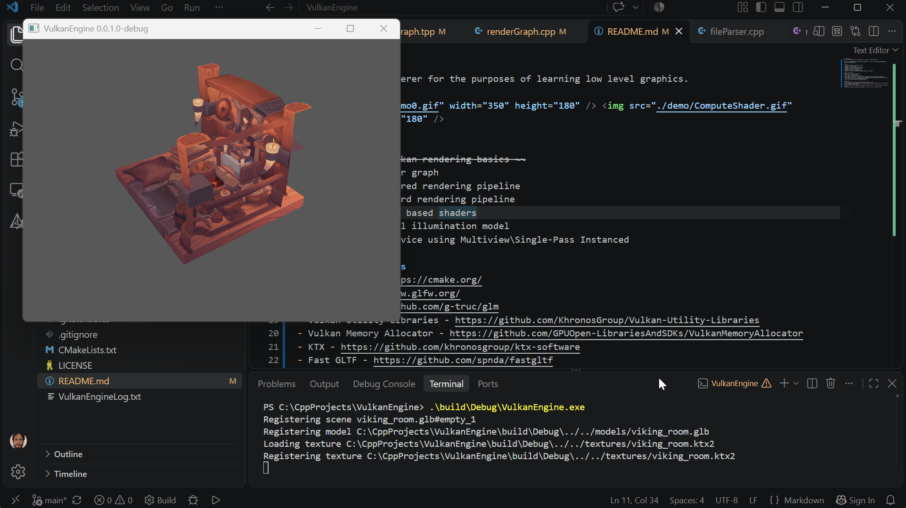
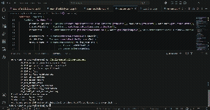

# VulkanEngine
A basic Vulkan Renderer for the purposes of learning low level graphics APIs.

 

# Goals
- ~~Understand Vulkan rendering basics~~
- Implement a render graph
- Implement a deferred rendering pipeline
- Implement a forward rendering pipeline
- Implement physics based shaders
- Implement a global illumination model

# Build Requirements
- CMake 4.3.1 - https://cmake.org/
- GLFW - https://www.glfw.org/
- GLM - https://github.com/g-truc/glm
- Vulkan Utility Libraries - https://github.com/KhronosGroup/Vulkan-Utility-Libraries
- Vulkan Memory Allocator - https://github.com/GPUOpen-LibrariesAndSDKs/VulkanMemoryAllocator
- KTX - https://github.com/khronosgroup/ktx-software
- Fast GLTF - https://github.com/spnda/fastgltf

# References
- https://docs.vulkan.org/tutorial/latest/00_Introduction.html
- https://themaister.net/blog/2017/08/15/render-graphs-and-vulkan-a-deep-dive/ - Good reference for understanding render graphs
- https://logins.github.io/graphics/2021/05/31/RenderGraphs.html - Render graphs and resource aliasing
- https://www.youtube.com/watch?v=x8v656d3pc4 - Fixed size staging buffers
